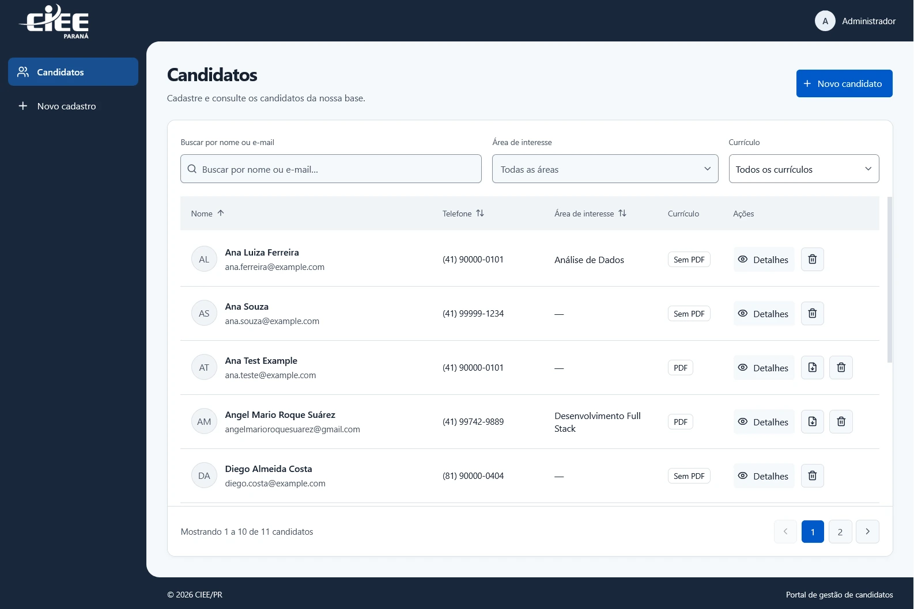
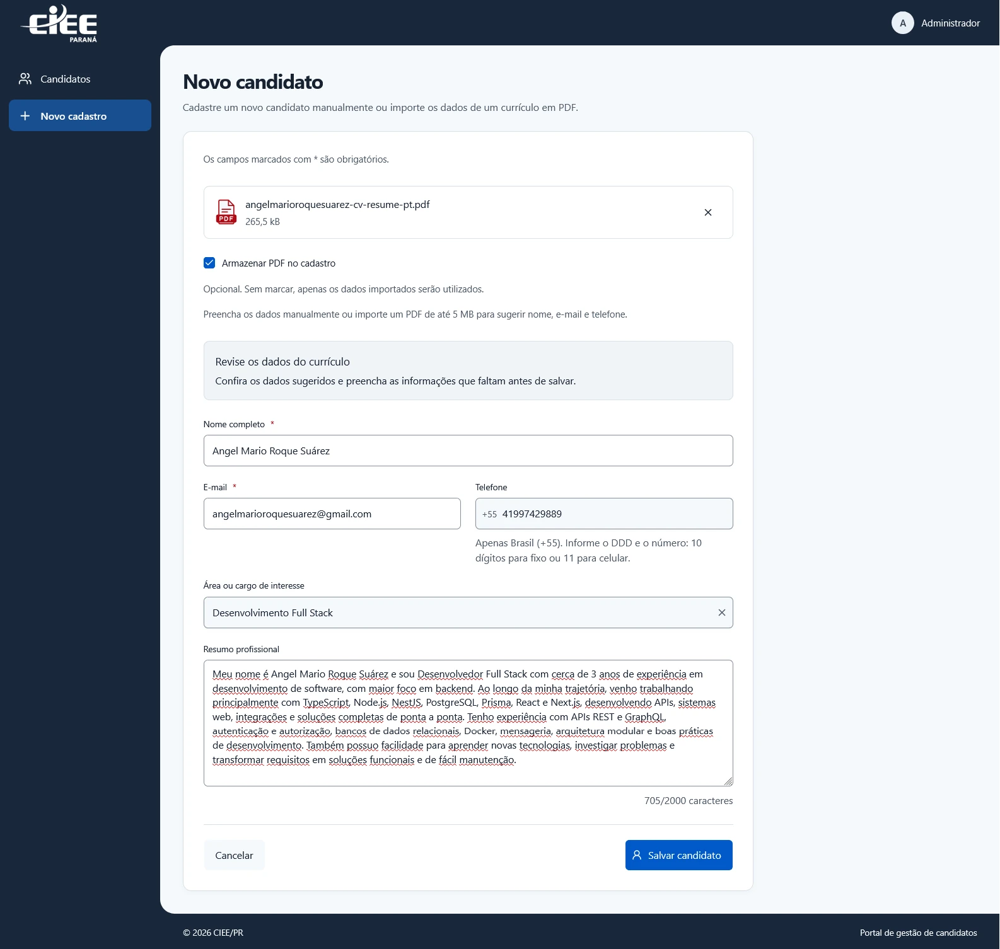
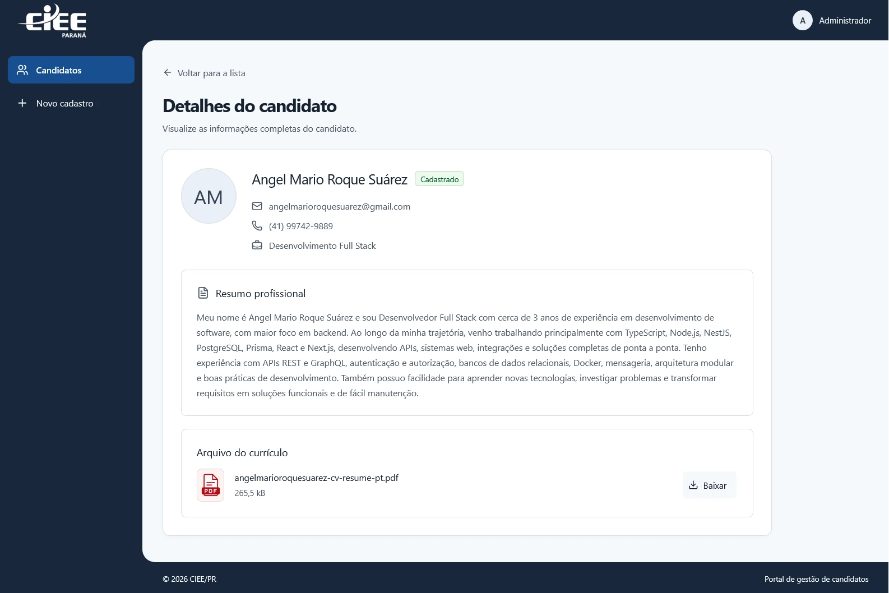
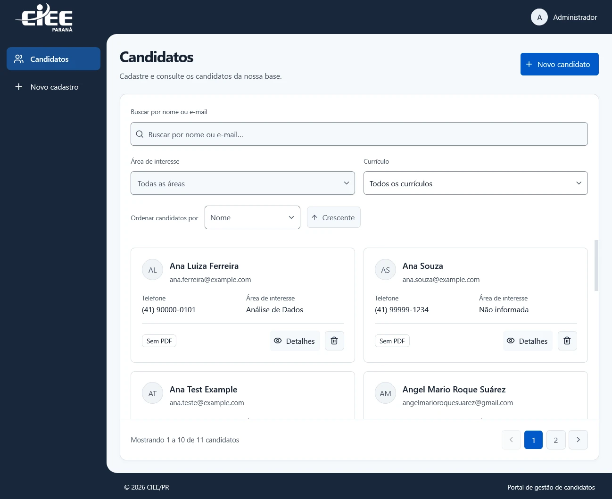
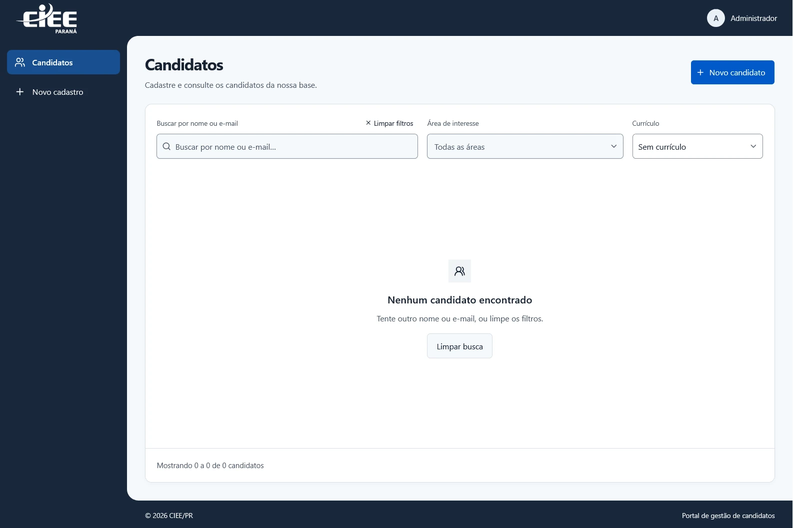

# CIEE Currículos

**Versão do projeto: 1.0.0.**

Aplicação desenvolvida para o desafio técnico do CIEE/PR: cadastro manual ou assistido por currículo PDF, revisão dos dados, listagem e consulta de detalhes. A solução integra React, uma API Node.js com NestJS e persistência no SQL Server.

**[Leia a documentação técnica em PDF](docs/documentacao-tecnica/main.pdf)** — solução entregue, telas reais, decisões técnicas, verificações e 13 diagramas da implementação. Os [fontes LaTeX e o projeto Visual Paradigm](docs/documentacao-tecnica/README.md) também estão disponíveis para consulta.

## A aplicação em uso



| Cadastro e revisão do PDF | Detalhes e acesso ao currículo |
| --- | --- |
| [](docs/images/cadastro-importacao-pdf.webp) | [](docs/images/candidato-detalhes.webp) |

As capturas mostram a aplicação em execução. Clique nas imagens para abrir em tamanho completo.

<details>
<summary>Ver layout em cartões e estado sem resultados</summary>

| Layout adaptável em cartões | Filtro sem resultados |
| --- | --- |
| [](docs/images/candidatos-cartoes.webp) | [](docs/images/candidatos-filtro-sem-resultados.webp) |

</details>

## O que foi entregue

- **Dois caminhos, um formulário:** cadastro manual ou sugestões de nome, e-mail e telefone extraídas do PDF pelo backend, com revisão antes de salvar.
- **PDF opcional:** falhas de leitura permitem continuar manualmente; guardar o arquivo é uma escolha explícita.
- **Consulta de candidatos:** listagem e detalhes, com busca, filtros, ordenação, paginação e layout adaptável.
- **Dados consistentes:** validações compartilhadas entre frontend e backend, e-mail único e normalizado, telefone brasileiro com DDD e área ou cargo restrito às opções predefinidas.
- **Gestão do currículo:** armazenamento opcional em RustFS/S3, download e exclusão individual com confirmação.
- **Avaliação reproduzível:** Docker Compose, migrations SQL Server, currículo fictício, testes e documentação interativa da API.

O [relato de desenvolvimento](DESENVOLVIMENTO.md) explica as decisões, a participação da IA e o tempo dedicado. O [registro de qualidade](QUALIDADE.md) relaciona os cenários verificados e os relatórios de cobertura.

## Requisitos

- Node.js 22 ou superior
- pnpm 11
- Docker Desktop para executar a stack local com Docker Compose

## Início rápido

Para avaliar a aplicação completa, crie o arquivo de configuração na raiz do repositório:

```bash
cp apps/backend/.env.example apps/backend/.env
```

No PowerShell, use `Copy-Item apps/backend/.env.example apps/backend/.env`. Configure `SQLSERVER_PASSWORD` e inicie a stack:

```bash
pnpm docker:up
```

Ou execute diretamente, sem depender dos scripts pnpm:

```bash
docker compose --env-file apps/backend/.env up -d --build
```

O Compose prepara o banco, aplica as migrations e inicializa o bucket de currículos antes de disponibilizar a API.

| Serviço                 | Endereço local               |
| ----------------------- | ---------------------------- |
| Aplicação               | <http://localhost:3001>      |
| API                     | <http://localhost:3000/api>  |
| Documentação interativa | <http://localhost:3000/docs> |
| Console RustFS          | <http://localhost:9001>      |

### Experimentar o fluxo principal

1. Abra **Novo candidato** e preencha os campos manualmente ou selecione [curriculo-ficticio.pdf](examples/curriculo-ficticio.pdf).
2. Confira as sugestões e complete os dados. Se desejar guardar o arquivo, marque a opção correspondente.
3. Salve e consulte os detalhes. Volte à listagem para experimentar busca, filtros e ordenação.

## Desenvolvimento local

Instale as dependências na raiz do repositório:

```bash
pnpm install
```

Crie o arquivo de ambiente do backend a partir do modelo e configure uma senha para o SQL Server:

```bash
cp apps/backend/.env.example apps/backend/.env
```

No PowerShell:

```powershell
Copy-Item apps/backend/.env.example apps/backend/.env
```

O modelo contém uma senha destinada apenas ao desenvolvimento. Substitua-a por uma senha segura antes de compartilhar o ambiente ou fazer uma implantação. Para o desenvolvimento local, inicie o SQL Server e gere o cliente Prisma:

```bash
pnpm db:start
pnpm prisma:generate
pnpm prisma:migrate:deploy
```

Para exercitar o armazenamento opcional, inicie também os serviços de arquivos:

```bash
docker compose --env-file apps/backend/.env up -d rustfs rustfs_init
```

Crie `apps/web/.env.local` com `VITE_SERVER_URL=http://localhost:3000`.

`pnpm db:start` inicia o serviço `sqlserver` definido no Docker Compose; a verificação de saúde cria `backend_db` se o banco ainda não existir. Se você usar outra instância do SQL Server, configure a conexão em `apps/backend/.env` e confirme que o banco de dados já existe.

Inicie o frontend e o backend:

```bash
pnpm dev
```

- Web: <http://localhost:3001>
- API: <http://localhost:3000/api>
- Documentação interativa da API: <http://localhost:3000/docs>

O fluxo principal permite cadastrar candidatos manualmente ou importar sugestões de um PDF, revisar os mesmos campos e salvar. A listagem oferece busca, filtros, ordenação, paginação e acesso aos detalhes. O PDF é opcional, inclusive quando sua leitura falha.

## Tecnologias e versões

Versões declaradas no workspace: React 19.2.8, Vite 8.2.2, TanStack Router 1.170.32, TanStack Query 5.104.0, NestJS 12.0.1, Prisma 7.10.0, Zod 4.5.4 e pdf-parse 2.4.5. O ambiente usa Node.js 22+, pnpm 11.8.0, SQL Server no Docker Compose e RustFS compatível com S3. O lockfile fixa as versões resolvidas.

Para testar a importação, selecione [examples/curriculo-ficticio.pdf](examples/curriculo-ficticio.pdf) no formulário de novo candidato. Confira nome, e-mail e telefone sugeridos antes de salvar. PDFs digitalizados não têm OCR; textos complexos ou contatos ambíguos podem exigir preenchimento manual. O relato de desenvolvimento e uso de IA está em [DESENVOLVIMENTO.md](DESENVOLVIMENTO.md).

Para anexar e armazenar PDFs, inicie também RustFS e prepare o bucket conforme o [README do backend](apps/backend/README.md). A documentação interativa está em `/docs` e o contrato JSON em `/openapi.json`.

## Variáveis de ambiente

O backend carrega `apps/backend/.env`. O modelo `apps/backend/.env.example` documenta as seguintes variáveis:

- `PORT`: porta HTTP da API (padrão: `3000`).
- `CORS_ORIGIN`: origem permitida pelo CORS.
- `TRUSTED_PROXY_IPS`: lista de IPs/CIDRs de proxies confiáveis, separada por vírgulas; vazia por padrão.
- `SQLSERVER_HOST`, `SQLSERVER_PORT`, `SQLSERVER_DATABASE`, `SQLSERVER_USER`, `SQLSERVER_PASSWORD`: conexão com o SQL Server.
- `SQLSERVER_ENCRYPT` e `SQLSERVER_TRUST_SERVER_CERTIFICATE`: opções TLS da conexão.

O frontend exige `VITE_SERVER_URL`, por exemplo `http://localhost:3000`. O Vite valida essa variável ao iniciar e ao compilar. Para desenvolvimento local, você pode defini-la em `apps/web/.env.local`.

## Banco de dados e Prisma

Os comandos executados na raiz iniciam as tarefas do Prisma em `apps/backend`:

```bash
pnpm prisma:generate
pnpm prisma:format
pnpm prisma:push
pnpm prisma:migrate
pnpm prisma:migrate:deploy
pnpm prisma:studio
```

`prisma:migrate` executa `prisma migrate dev` e destina-se ao desenvolvimento; `prisma:migrate:deploy` aplica migrações existentes em implantações. Consulte [apps/backend/README.md](apps/backend/README.md) para obter detalhes da configuração do SQL Server.

## Docker Compose

O Compose precisa do arquivo de ambiente do backend para interpolar `SQLSERVER_PASSWORD`. Crie-o a partir do modelo antes de iniciar a stack:

```bash
cp apps/backend/.env.example apps/backend/.env
```

No PowerShell:

```powershell
Copy-Item apps/backend/.env.example apps/backend/.env
```

Troque a senha de exemplo por uma senha de desenvolvimento segura. Os scripts da raiz já passam esse arquivo:

```bash
pnpm docker:build
pnpm docker:up
pnpm docker:logs
pnpm docker:down
```

Também é possível executar o Compose diretamente:

```bash
docker compose --env-file apps/backend/.env up --build
```

O Compose compila as imagens sem copiar arquivos `.env` para elas. O Prisma Client é gerado com credenciais descartáveis exclusivas da etapa de build; em execução, a aplicação recebe a configuração definida pelo Compose.

A imagem do backend usa uma etapa separada de compilação. A etapa final contém o backend compilado, o pacote compartilhado compilado e dependências de produção, sem ferramentas de teste ou caches do build. O Prisma CLI e o engine de migração permanecem na imagem para aplicar migrations antes do servidor iniciar. O processo roda com o usuário `node`.

A stack publica a aplicação web na porta `3001`, a API em `127.0.0.1:3000` e o SQL Server em `127.0.0.1:1433`. `APP_PORT` altera a porta da API publicada no host e `SQLSERVER_PORT` altera a porta do SQL Server no host; dentro da rede do Compose, a API sempre se conecta a `sqlserver:1433`.

O valor de `VITE_SERVER_URL` é incorporado ao bundle durante a compilação; o padrão é `http://localhost:3000`. Para usar outra origem, defina `VITE_SERVER_URL` em `apps/backend/.env`; escolha uma URL acessível pelo navegador, não o nome interno `backend`. `CORS_ORIGIN` também pode ser configurada nesse arquivo e, por padrão, permite `http://localhost:3001`.

## Principais scripts

| Comando | Descrição |
| --- | --- |
| `pnpm dev` | Inicia as aplicações em modo de desenvolvimento. |
| `pnpm dev:web` | Inicia apenas a aplicação web. |
| `pnpm dev:backend` | Inicia apenas o backend. |
| `pnpm build` | Compila as aplicações. |
| `pnpm check-types` | Executa as verificações de tipos definidas no workspace. |
| `pnpm check` | Verifica formatação e lint com Ultracite. |
| `pnpm fix` | Aplica correções de formatação e lint. |
| `pnpm db:start` | Inicia o SQL Server pelo Compose. |

## Estrutura

```text
apps/
  backend/   API NestJS, Prisma, configuração e testes
  web/       Aplicação React, Vite e TanStack Router
packages/
  config/    Pacote de configuração do workspace
  shared/    Contratos, tipos e validações Zod usados nos dois lados
  ui/        Componentes React compartilhados e estilos
```

## Qualidade e testes

```bash
pnpm check
pnpm check-types
pnpm test
pnpm --filter backend test
pnpm --filter web test:cov
pnpm --filter backend test:cov
pnpm --filter backend test:e2e
pnpm --filter backend test:e2e --coverage
```

`pnpm test` executa os testes unitários dos pacotes. Os e2e da API precisam de SQL Server e RustFS disponíveis e usam um banco dedicado. Os relatórios de cobertura ficam em `apps/backend/coverage`, `apps/backend/coverage-e2e` e `apps/web/coverage`, com HTML, resumo JSON e LCOV. Cada suíte possui uma medição independente. Consulte o [README do backend](apps/backend/README.md#testes) para preparar o ambiente e [QUALIDADE.md](QUALIDADE.md) para conhecer os cenários e resultados registrados.
